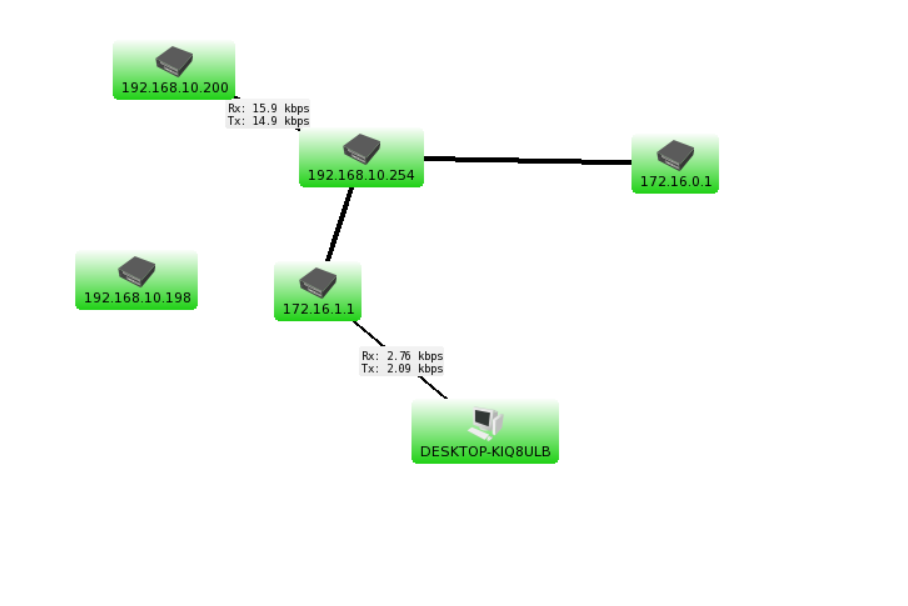
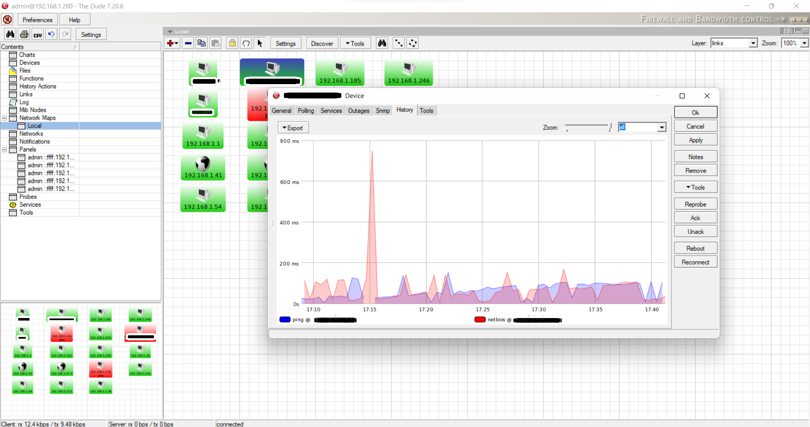
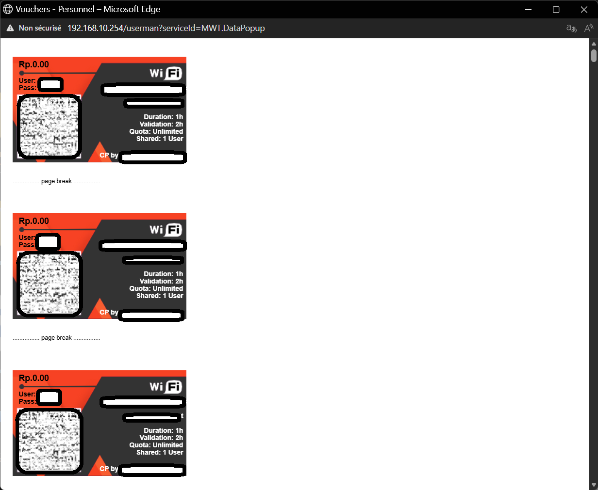

# MikroTik Captive Portal and Network Monitoring with The Dude

Deployment of a captive portal (Hotspot) on a MikroTik router, combined with real-time network monitoring using The Dude. Built at a small IT services company (As a technician in Networks and IT Security) in Douala, Cameroon.

🇫🇷 [Version française](README.fr.md)

## Why this project

An uncontrolled guest Wi-Fi network creates four problems: unauthorized access, unfair bandwidth sharing, no traceability of connections, and a risk of saturation and outages. This project answers them with one low-cost stack: a MikroTik router that authenticates and limits users, and a monitoring tool that shows the state of devices and traffic.

## Objectives

- Authenticate guest users through a captive portal.
- Control and limit access according to predefined user profiles.
- Limit bandwidth per profile, in a way that is measurable.
- Keep connection logs and session statistics.
- Monitor devices and traffic in real time, with notifications when a service goes down.

## Architecture


The guest Wi-Fi (hotspot) and the internal LAN sit on separate bridges of the same router. The ISP modem feeds the router's WAN port.

| Network | Address | Role |
| --- | --- | --- |
| WAN (ether1) | 10.5.50.0/24 (NAT) | Uplink to the modem |
| Hotspot bridge | 172.16.0.0/24 | Guest Wi-Fi clients |
| Internal bridge | 172.16.1.0/24 | Administration and servers |
| LAN | 192.168.10.0/24 | Office network |

### Equipment and software

- MikroTik RB951Ui-2HnD (MIPSBE), RouterOS 6.49.19: hotspot, DHCP, NAT, firewall, User Manager.
- Internet modem (box) and a switch for the internal network.
- Administration PC with VirtualBox hosting a RouterOS CHR 7.20.8 virtual router.
- WinBox, a web browser, The Dude client 7.20.8 (ports 2210 and 8291).

**Why a virtual router?** The physical router ran a RouterOS version older than 7.10, which lacked services The Dude needs. The Dude server therefore runs on a virtual RouterOS 7.20.8 instance on the administrator's PC, attached to the internal bridge.

### Planning and cost

The plan covered about 55 working days: environment study (5), hardware purchase (5), router and admin PC installation (10), network setup (10), captive portal and The Dude configuration (20), tests (5). The estimated total cost was about 400,000 FCFA, including 150,000 FCFA of labor. RouterOS and The Dude add no software cost.

## Implementation

1. **Router preparation.** Bridges for the hotspot and the internal network, IP addressing, a DHCP client on the WAN, and bridge port assignment.
2. **Hotspot server.** A hotspot server on the hotspot bridge with its own address pool. The server profile allows cookie and MAC-cookie login with HTTP CHAP and PAP, with a 3-day cookie lifetime.
3. **User profile.** One profile with a 1-hour session timeout, one shared user per account, a rate limit of 512 kbps up and 1 Mbps down, and a status page shown after login.
4. **User management, two methods.**
   - Local hotspot users, each assigned a profile.
   - RADIUS through MikroTik User Manager (authentication on port 1812, accounting on 1813), with the router registered in User Manager.
   - Printable vouchers generated by User Manager: QR code, 1 hour of connection time, valid for 2 hours, unlimited quota, one shared user.
5. **Custom captive page.** A branded login page written in HTML, CSS and JavaScript, using the hotspot's CHAP login form.
6. **Isolation.** Firewall and NAT rules separate hotspot clients from the internal network while allowing Internet access.
7. **Monitoring with The Dude.** Package compatible with the router version, client connection, then network discovery (device types, networks, links, layer 2 structure, service poll times). Network map, service probes with history graphs, and a notification log.

## Results

- **Client side.** A user joining the open Wi-Fi is redirected to the login page. After authentication, a status page shows the assigned IP address, bytes uploaded and downloaded, and session time.
- **Monitoring.** The Dude discovers and maps devices: green when a probe answers, red when it times out. Service history graphs show latency over time, and the notification log records when a service goes down or comes back, with timestamps.
- **Observation.** One latency graph shows a transient spike close to 800 ms. The cause was not investigated, so this repository does not claim one.

## Screenshots

**The Dude network map.** The router, the hotspot and internal bridges, and a client, with live traffic on each link.



**Service history in The Dude.** Ping and NetBIOS latency over time for one monitored device, showing the transient spike mentioned above.



**Printable vouchers.** Generated by User Manager: QR code, 1 hour of connection time, valid for 2 hours, one shared user. All credentials are removed.



## Limitations and next steps

- The router runs an older RouterOS 6 release: plan an upgrade to RouterOS 7.
- The captive portal is served over HTTP with no certificate configured: add HTTPS.
- Shared secrets and passwords must be strong and rotated: the sanitized files in this repository use placeholders.
- Log storage is limited: add remote syslog and retention rules.
- Alerts stay inside The Dude: add e-mail or chat notifications.
- Configuration is applied by hand: export it, version it and automate deployment (see the next project in my portfolio: network configuration as code).

## Skills demonstrated

RouterOS administration (bridges, DHCP, NAT, firewall, Hotspot, User Manager), RADIUS-based authentication, bandwidth control, captive page customization, network discovery and monitoring with The Dude, network diagramming, technical documentation.

## Repository layout

```
├── README.md          English documentation
├── README.fr.md       French documentation
├── docs/              architecture diagram and sanitized screenshots
├── portal/            captive page (HTML, CSS, JS) with a generic logo
```

Screenshots and exports in this repository contain no passwords, shared secrets, device names or personal data.

## Author

Josias Foguieng Kamga, Bachelor student in Networks and Security.
[Portfolio](https://josias-kamga.github.io/portfolio/) · [GitHub](https://github.com/Josias-Kamga) · [LinkedIn](www.linkedin.com/in/josiaskamga)

## License

MIT, see [LICENSE](LICENSE).
